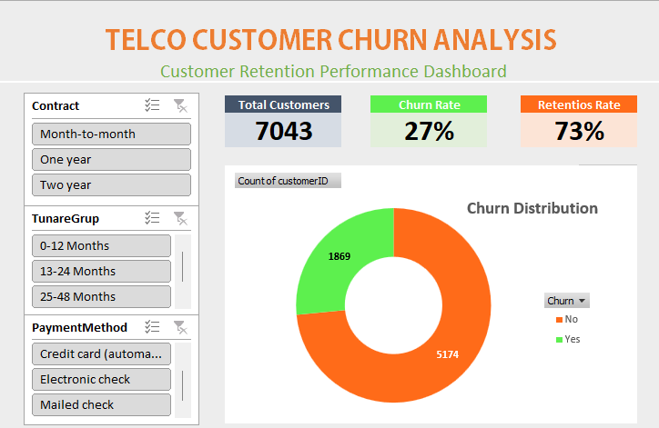
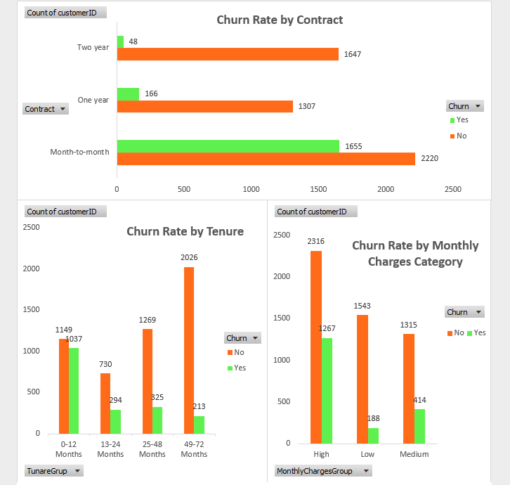
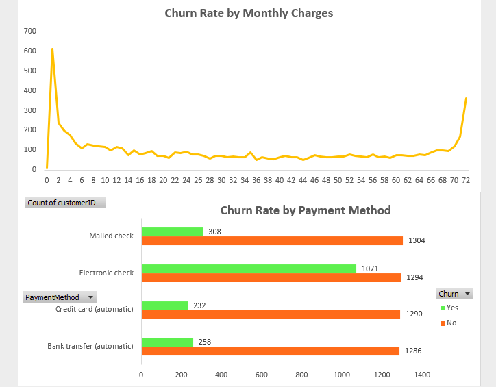

# Telco Customer Churn Analysis Using Microsoft Excel

## Project Overview
This project analyzes customer churn patterns in a telecommunications company using Microsoft Excel. The analysis aims to identify customer segments with higher churn levels, explore factors associated with customer attrition, and provide data-driven recommendations to support customer retention strategies.

The project covers data cleaning, exploratory data analysis (EDA), customer segmentation, churn analysis, and interactive dashboard development.

## Objectives
- Analyze the overall customer churn pattern.
- Identify customer segments with significant churn.
- Examine the relationship between monthly subscription charges and customer churn.
- Analyze churn patterns based on customer tenure.
- Evaluate churn across contract types and payment methods.
- Develop recommendations to improve customer retention.

## Dataset
- **Source:** IBM Telco Customer Churn Dataset
- **Platform:** Kaggle
- **Dataset Link:** https://www.kaggle.com/datasets/blastchar/telco-customer-churn
- **Total Records:** 7,043 customers
- **Total Columns:** 21

Key variables used in the analysis include:
- `customerID`
- `tenure`
- `Contract`
- `MonthlyCharges`
- `TotalCharges`
- `PaymentMethod`
- `Churn`

## Tools & Technologies
- Microsoft Excel
- Excel Formulas
- Data Cleaning
- PivotTables
- PivotCharts
- Data Visualization
- Interactive Dashboard

## Project Workflow

### 1. Data Cleaning
- Reviewed dataset structure and data quality.
- Checked missing values and duplicate customer records.
- Reviewed and standardized data formats and categories.
- Prepared data for further analysis.
- Created customer segmentation categories based on tenure and monthly subscription charges.

### 2. Exploratory Data Analysis (EDA)
Explored customer characteristics and churn distribution to understand patterns in customer attrition.

### 3. Customer Churn Analysis
Analyzed customer churn across several dimensions:
- Monthly Charges Category
- Customer Tenure
- Contract Type
- Payment Method

### 4. Dashboard Development
Created an Excel dashboard to present key performance indicators, churn patterns, and customer segment comparisons through charts and visual summaries.

## Key Findings

The analysis identified the following churn segments:

| Customer Segment | Churned Customers |
|---|---:|
| Month-to-Month Contract | 1,605 |
| High Monthly Charges | 1,267 |
| Electronic Check Payment | 1,071 |
| Early Tenure (0–12 Months) | 1,037 |

**Key Observations:**

1. **Month-to-Month Contract:** This segment recorded the highest number of churned customers, with 1,605 customers.
2. **High Monthly Charges:** A total of 1,267 churned customers belonged to the High Monthly Charges category.
3. **Electronic Check:** 1,071 churned customers used Electronic Check as their payment method.
4. **Early Tenure:** 1,037 churned customers had a subscription tenure of 0–12 months.

*Note: These segments may overlap. The figures represent customer counts within each segment and should not be added together as unique churned customers.*

## Business Recommendations

- **Contract Strategy:** Encourage long-term subscriptions through loyalty programs and attractive contract incentives.
- **Pricing Strategy:** Review subscription pricing and service value for customers with higher monthly charges.
- **Payment Experience:** Evaluate the payment experience and encourage convenient alternative payment methods.
- **Early Customer Retention:** Strengthen onboarding and customer engagement during the first 12 months.

## Project Deliverables
- Cleaned dataset
- Customer churn analysis
- Excel dashboard
- Key insights and business recommendations

## Conclusion
This project demonstrates the use of Microsoft Excel to transform raw customer data into meaningful business insights. By identifying customer segments with significant churn, the analysis provides a foundation for developing more targeted customer retention strategies.
